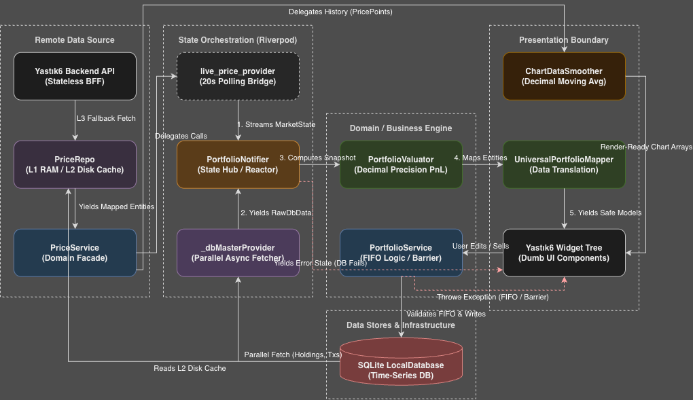

# Yastık6

[](https://github.com/cinargorkemturudu/yastik6-app/actions/workflows/flutter-test.yml)

[](LICENSE)

A local-first Flutter app for tracking a gold / currency / crypto portfolio. Holdings, transactions, and P&L live in an on-device SQLite database; the backend API is only used to refresh live market prices.

**Demo video:** [Yastık6 – Portfolio tracker demo](https://youtu.be/JhnMPA0rF7U) · **Backend:** [yastik6-backend](https://github.com/cinargorkemturudu/yastik6-backend) · **Project story:** [Portfolio showcase](https://github.com/cinargorkemturudu/Yastik6-Portfolio-Showcase)



## Stack

- Flutter/Dart (`yastik_alti`), SDK `^3.10.1`
- **sqflite** as the primary data store (local-first: the app works fully offline against last-synced data)
- **Riverpod** for state management and DI (`lib/di/providers.dart`)
- **envied** to embed API secrets at compile time (obfuscated, generated, gitignored)

## Architecture

```
domain   → models/entities/value objects, repository interfaces
data     → local/ (sqflite), remote/ (API client), repositories/ (implements domain interfaces)
di       → Riverpod provider wiring
ui       → screens, widgets, state (Riverpod controllers/view models)
```

`lib/data/remote/remote_market_data.dart` is the only HTTP client. It calls `GET {BASE_URL}/api/prices/market` with an `X-Mobile-Client-Key` header, and defensively discards individual assets that fail to parse rather than failing the whole batch.

`PortfolioValuator.compute` (`lib/domain/services/portfolio_valuator.dart`) is the core P&L engine: it prices every holding against the latest quote, falls back to the last known on-device price when a live quote is missing or zero, and computes per-lot and portfolio-level profit.

## Getting started

Requires the Flutter SDK (stable channel).

```bash
flutter pub get
```

Copy the template and fill it in:

```bash
cp .env.example .env
```

`YASTIK6_API_KEY` must match the backend's `ApiSettings__MobileClientKey`. `GOOGLE_DRIVE_CLIENT_ID` is only needed for cloud backup. To try the app without the production API, run the backend locally (see its README) and point `BASE_URL` at it.

Then generate the obfuscated env bindings (required after every `.env` change):

```bash
dart run build_runner build --delete-conflicting-outputs
flutter run
```

### Pointing at a local backend

`BASE_URL` defaults to production (`https://yastik6.net`). To hit a locally running backend instead (`dotnet run` in `backend/`, listening on `http://0.0.0.0:5179`), set `BASE_URL=http://localhost:5179` in `.env` and rerun the codegen above.

## Testing

```bash
flutter test
```

Covers pure formatting/parsing logic (`AppFormatter.parseInput` — the various number formats a user might type), the portfolio valuation engine (profit/loss math, indicator-asset exclusion, price-fallback behavior, multi-holding aggregation, per-lot breakdown, division-by-zero guards), and a couple of shared widgets (`AppSafeText`, `AppOutlinedCard`).

CI (`.github/workflows/flutter-test.yml`) runs the full suite on every push/PR to `main`.
